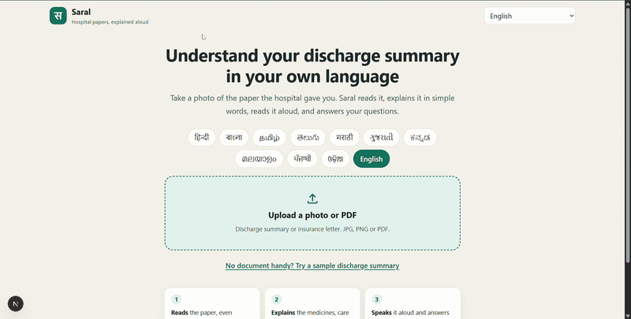

# Saral: hospital papers, explained aloud

Upload a photo or PDF of a hospital discharge summary and Saral explains it in simple words in your own language, reads it aloud, and answers spoken questions about it. Built on Sarvam AI.

## Demo

[](demo/saral-demo.mp4)

The preview above is silent and plays at double speed. [Watch the full demo with sound](demo/saral-demo.mp4) (1.5 minutes).

## Run it

```
npm install
```

Put your key in `.env`:

```
SARVAM_API_KEY=your-key
```

Then start the app and open http://localhost:3000:

```
npm run dev
```

There is a "Try a sample discharge summary" link on the first screen, so no document is needed to see it work. The sample is a fictional patient.

## What it does

1. **Reads** the document, including scans and phone photos.
2. **Explains** it in one of 11 languages: a short summary, each medicine with morning, afternoon and night timings, a home-care checklist, follow-up visits with calendar reminders, warning signs, and a glossary of the medical terms used.
3. **Speaks** the summary and any section aloud.
4. **Answers questions** asked by voice or typing, using only what the document says.

Every item links back to the part of the document it came from, which is highlighted on the page.

## Sarvam APIs used

| Step | API | Where |
|---|---|---|
| Read the document | Document AI (`docAi.digitise`) | `lib/document.ts` |
| Explain it | Chat completions, `sarvam-105b` | `lib/explain.ts` |
| Read aloud | Text to speech, `bulbul:v3` | `app/api/speak/route.ts` |
| Hear a spoken question | Speech to text, `saaras:v3` | `app/api/ask/route.ts` |
| Answer the question | Chat completions, `sarvam-105b-conversations` | `lib/explain.ts` |

## Keeping it faithful to the document

The explanation is for patients, so the app is built to explain what the paper says and nothing more:

- The prompts forbid adding diagnoses, medicines, doses or advice that are not in the document.
- Medicine names, glossary terms and the emergency number are dropped in code unless they literally appear in the document text.
- Dose patterns such as `1-0-1` are parsed in code, not left to the model.
- For the spoken summary, the model first quotes the document's own lines and is told to write only from those.
- Answers that come back in the wrong language or script are retried once.

It is not medical advice, and the app says so on every screen.
